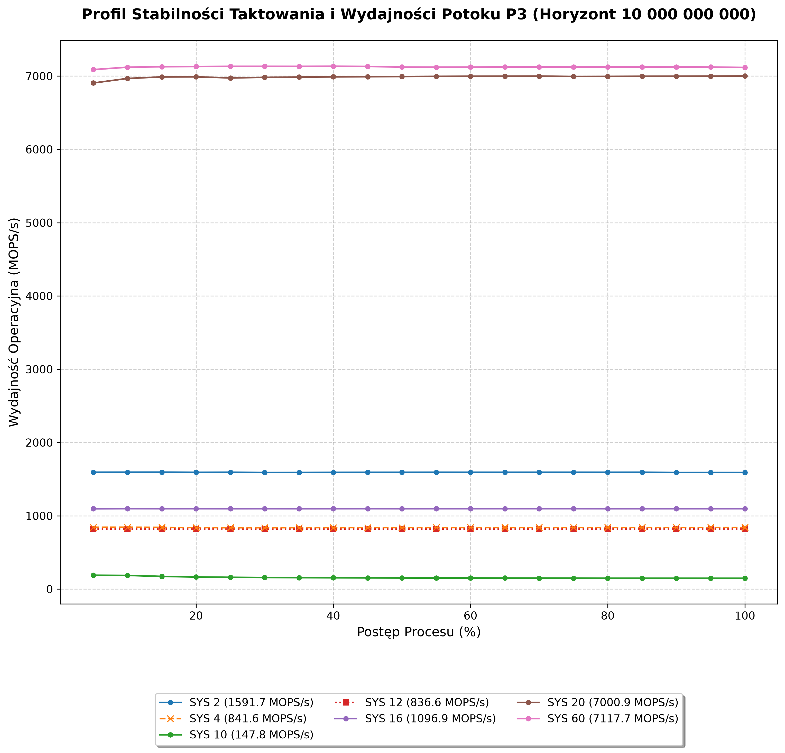
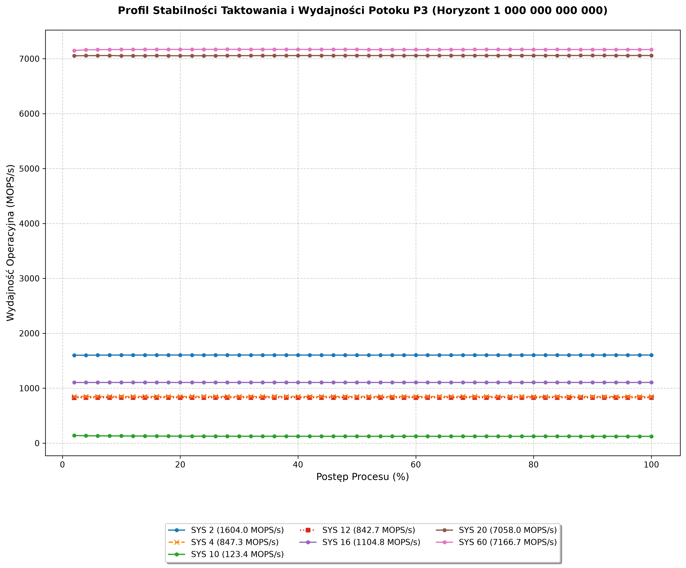

# ECHOKOSMOS
### ARCHITEKTURA SYSTEMOWA STANDARDU 585

Prezentuję pierwszy element projektu **Echokosmos**: 
**H.U.S.A.R.Z. — Holomorficzny Uziemiony Splotowy Aktywator Rezonatora Zibi**.

## Opis projektu: 
Repozytorium zawiera deterministyczny potok nieliniowy działający w Standardzie 585 - rdzeń obliczeniowy C++ (husarz.cpp v1.04) który realizuje wielobazowe sploty drzewiaste oraz bezskokowe operacje modularne w systemach: 2, 4, 10, 12, 16, 20 i 60.

## Środowisko Testowe : 
*   **Procesor:** Intel Core i5-9400F CPU @ 2.90GHz (Turbo do 4.10 GHz, 9 MB Intel Smart Cache)
*   **Płyta główna:** ASUS ROG Maximus XI Hero
*   **Pamięć RAM:** 16.0 GB DDR4
*   **Karty graficzne:** NVIDIA Quadro M6000 24 GB VRAM + NVIDIA GeForce GTX 1080 8 GB VRAM
*   **Pamięć masowa:** Intel SSDPEKNW512G8H 512 GB, NVMe M.2
*   **System operacyjny:** Windows 10 Home N 

## Kompilacja modułu:
> [!IMPORTANT]
> Wymagany jest kompilator MSVC (x64) zainstalowany z Visual Studio!!!

```bash
pip install pybind11 numpy matplotlib
python setup.py build_ext --inplace
```

Repozytorium zawiera trzy benchmarki:
*   `run_benchmarks.py` — jest to dwuetapowy interfejs z możliwością wyboru bazy systemowej (2, 4, 10, 12, 16, 20, 60) oraz horyzontu obliczeniowego (10 miliardów, 100 miliardów lub 1 biliona).
*   `wykresy.py` — test generujący profil stabilności dla horyzontu 10 000 000 000 iteracji.
*   `wykresy_bilion.py` — test generujący profil stabilności dla horyzontu 1 000 000 000 000 iteracji.

## Wyniki wydajnościowe oraz wykresy z testów
Dane pokazują uzyskane przeze mnie wyniki dla dystansu 1 000 000 000 000 iteracji dla niżej wymienionych baz:

*   **SYS 60:** ~7166.7 MOPS/s
*   **SYS 20:** ~7058.0 MOPS/s
*   **SYS 2:**  ~1604.0 MOPS/s
*   **SYS 16:** ~1104.8 MOPS/s
*   **SYS 4:**  ~847.3 MOPS/s
*   **SYS 12:** ~842.7 MOPS/s
*   **SYS 10:** ~123.4 MOPS/s




## uwaga: Możliwa redukcja bezpętlowa Bazy 10 (O(1) Tree Reduction)
Aby wyeliminować sekwencyjny obrót pętli 'while' w funkcji fast_base10_sum_tree (generującej obecnie ~123 MOPS/s), można zaimplementować płaską, 3-krokową redukcję drzewiastą (Tree Reduction) która będzie działać w czasie stałym O(1). 

Algorytm zastępuje wtedy dzielenie przez 10 na dynamiczną korekcją nadmiaru bazy (Baza 16 -> Baza 10) w oparciu o wektorową wielokrotność kroku kompensacji (16 - 10 = 6) na stałych rejestrach przesunięcia bitowego:
```cpp
corrected_sum = hex_sum - fast_hex_digit_sum_tree(((u >> 4) & 0x0F0F0F0F0F0F0F0FULL) * 6)
```

## Dla wnikliwych:
*   [Paradoks Samozaciskającej się Pętli Logicznej (SPL): Bariera entropijna w optymalizacji systemów kognitywnych](https://doi.org/10.5281/zenodo.18048010)
*   [Analiza teoretyczna stabilności kognitywnej i termodynamicznej systemów LLM: Formalizacja punktu osobliwości SPL-666](https://doi.org/10.5281/zenodo.18108137)
*   [Teoretyczne ujęcie Gradientu Informacyjnego Krzemu (GIK) i punktu G-RIP](https://doi.org/10.5281/zenodo.18158033)
*   [Termodynamika Struktur Kognitywnych: Rezystancja Informacyjna (Rinf) i Formalny Dowód Nierówności Klas P oraz NP](https://doi.org/10.5281/zenodo.18208920)
*   [Strunalizm: Osobliwość statystyczna jako patologia projektowa współczesnej fizyki teoretycznej](https://doi.org/10.5281/zenodo.18342877)
*   [Prawa Włodarskiego vs. Strunalizm](https://doi.org/10.5281/zenodo.18422312)
*   [WITRYFIKACJA STRUNALIZMU: PROTOKÓŁ ZAMKNIĘCIA](https://doi.org/10.5281/zenodo.18451619)
*   [Prawa Włodarskiego vs Eter Tesli](https://doi.org/10.5281/zenodo.18486942)
*   [Kooperacja Włodarski & de Broglie - Formalizacja Tensora WS i Skalowanie Fali Pilotującej](https://doi.org/10.5281/zenodo.18600107)
*   [Formalizacja Matematyczna Ciągu Włodarskiego: Deterministyczny Nośnik Stabilizacji dla Standardu 585](https://doi.org/10.5281/zenodo.19019870)
*   [Formalizacja Matematyczna Ciągu Włodarskiego : Mechanizm Nieliniowej Adaptacji i Zarządzanie Świadomością Systemową (Warstwy P1–P3)](https://doi.org/10.5281/zenodo.20113665)
*   [Formalizacja Ciągu Włodarskiego: Kod Dziesiętny, Mechanizm Wahadłowy i Pusta Oś Sprawstwa Matrycy](https://doi.org/10.5281/zenodo.21324478)
*   [Analityczna rekonstrukcja dynamiki kwantowej: od trajektorii do biegunów macierzy S](https://doi.org/10.5281/zenodo.20478072)
*   [Geometria ontologiczna – eliminacja osobliwości i przełamująca redukcja dzielenia przez zero](https://doi.org/10.5281/zenodo.20708111)
*   [Uniwersalny operator patologii miarowej Ωultimate(¯x) i granice skalowania](https://doi.org/10.5281/zenodo.20836048)

## Inspiracje do pracy:
*   Michio Kaku "Fizyka rzeczy niemożliwych"
*   Shunryu Suzuki "Umysł zen, umysł początkującego"
*   Artur Lalak "Zabić Bogów" 

## Licencja
Dystrybucja na licencji Creative Commons Attribution-NonCommercial-NoDerivatives 4.0 International (CC BY-NC-ND 4.0)
